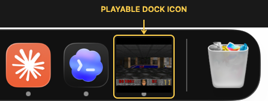
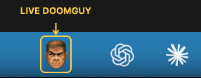
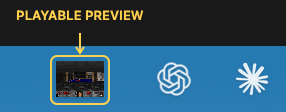
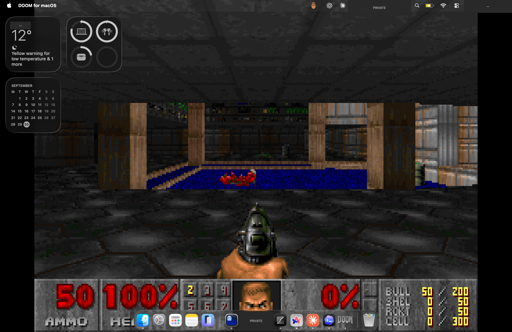
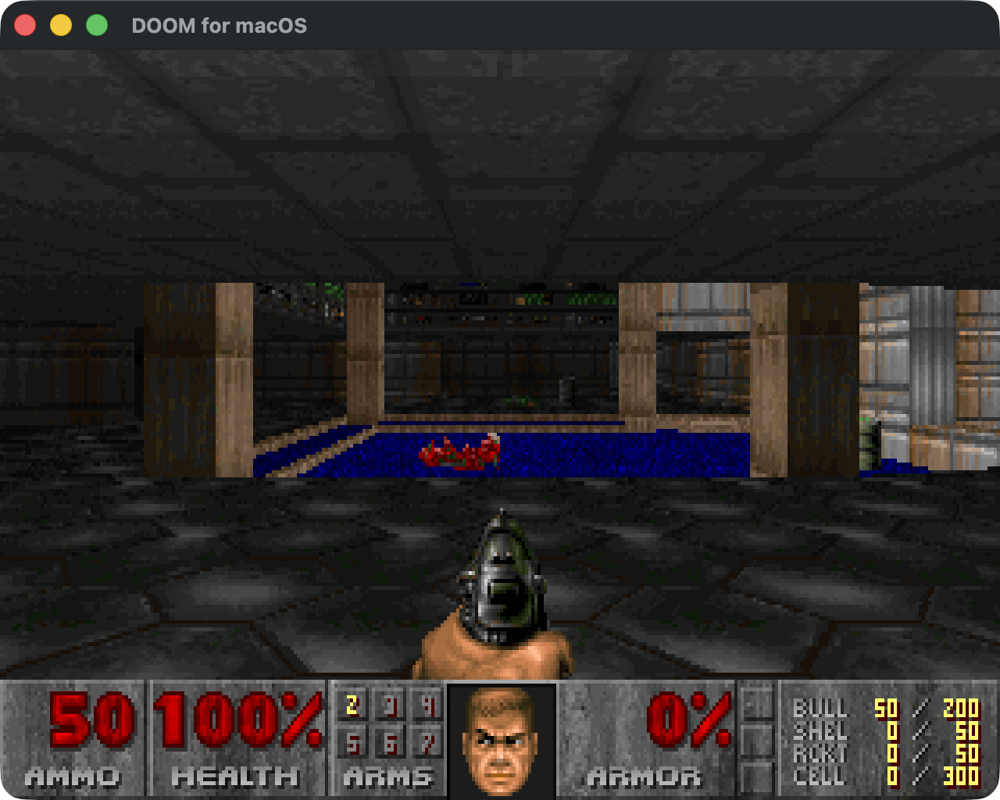

# DOOM for macOS

**DOOM doesn’t need a window.**

Play in your Dock, menu bar or desktop. Keep Doomguy beside your status icons. Switch to a regular window whenever you want — the same game keeps going.



*A playable DOOM level, right in your Dock.*

Built on [doomgeneric](https://github.com/ozkl/doomgeneric), with native AppKit rendering and stereo sound effects. No SDL or Homebrew required.

## Quick start

**Apple Silicon · macOS 13+ · Xcode or Command Line Tools · Python 3**

From the project directory:

```sh
bash build.sh --run
```

The first build needs internet access to download the pinned engine and shareware WAD. It verifies the downloads and creates `build/DOOM for macOS.app`; later builds reuse them. The app is locally signed, not notarized. Tested on macOS 26.7.

Click the Dock icon or menu-bar item to play. **F / Ctrl fires; Space / E opens doors.** Switching to another app pauses gameplay and sound.

## Pick a place to play

Right-click the Dock icon or the menu-bar item to switch modes. Your game continues from the same point; presentation preferences are saved.

| Mode | What it does |
| --- | --- |
| **Dock** | The game runs inside its Dock icon, with no game window. |
| **Menu Bar** | A tiny playable preview lives in the menu bar, with no game window. |
| **Desktop** | The game appears behind desktop icons and widgets on the primary display, with 4:3 letterboxing. Clicks pass through; your wallpaper stays unchanged. |
| **Window** | A resizable 640×480 window keeps the original 4:3 aspect ratio. Minimize to pause; close to return to Dock mode. |

### Screenshots

Real screenshots of the running app. Dock and menu-bar close-ups highlight the game in yellow; click the menu-bar images for the original captures.

**Doomguy in the menu bar** — reacts to combat while the game runs in another mode.

[](docs/screenshots/menubar-face-three-icons-context.png)

**Menu-bar gameplay** — the whole game beside your status icons.

[](docs/screenshots/menubar-game-three-icons-context.png)

**Live desktop** — a full macOS Space with DOOM behind the widgets, menu bar and Dock. Location, capture time and selected app icons are masked for privacy.

[](docs/screenshots/desktop-redacted.png)

<details>
<summary>Also plays in a regular window</summary>

[](docs/screenshots/window.png)

</details>

### A Doomguy in your menu bar

Choose **Doomguy Face** or **Game Preview** alongside Dock, Desktop or Window mode. The face follows the original reactions to combat and damage, even when the in-game HUD is hidden. Menu-bar-only mode always shows gameplay.

The menu-bar item keeps a fixed width, without moving labels. Hover for status and ammunition; right-click for presentation, sound and pause controls.

Sound effects, pause and presentation controls are available from the right-click menu. Rendering targets 30 fps with the original 4:3 proportions; the engine keeps its own tick rate. A gray pixel-art icon replaces the live Dock frame in other modes.

## Controls

| Key | Action |
| --- | --- |
| W / S or ↑ / ↓ | Move forward / backward |
| ← / → | Turn |
| A / D | Strafe |
| **F or Ctrl** | **Fire; hold for repeated shots** |
| Space / E | Open doors and activate switches |
| Shift | Run |
| Option + ← / → | Strafe |
| 1–7 | Select weapon |
| Tab | Automap |
| Esc | Game menu |
| ↑ / ↓, Enter | Navigate and select |
| Y / N | Confirm / cancel |
| ⌘Esc | Release keyboard focus |
| ⌘Q | Quit |

**Save:** Esc → Save Game → slot → name → Enter. Use digits `1–7` for names for now, such as `123`. **Load:** Esc → Load Game → slot → Enter.

Saves persist across app rebuilds in `~/Library/Application Support/DockDOOM/.savegame/`. There is no autosave or automatic resume. Music, mouse input, full save-name typing and quicksave/quickload hotkeys are not implemented. Original DOOM has no jump action.

## Game data

The build downloads the shareware first episode, [DOOM1.WAD](https://github.com/nneonneo/universal-doom/blob/main/DOOM1.WAD), into `assets/` and includes it in the local app bundle. **WAD files are not stored in Git.** See [third-party notices](THIRD_PARTY.md) for the pinned source, checksum and licensing.

The game starts at E1M1 on Hurt Me Plenty. To use your own WAD or open the title screen, quit the app first:

```sh
open "build/DOOM for macOS.app" --args --iwad /absolute/path/to/DOOM1.WAD --title-screen
```

Other WADs have not been tested. Configuration and `engine.log` live alongside the save folder in `~/Library/Application Support/DockDOOM/`.

## Development

```text
Sources/           AppKit shell, engine bridge, native audio
Resources/         App bundle metadata
docs/screenshots/  Actual app screenshots and annotated close-ups
Tests/             Engine and window integration tests
scripts/           Dependency download, icon generation, build helpers
build.sh           Build and optionally launch the app
```

```sh
bash build.sh
bash scripts/test-engine.sh
bash scripts/test-window.sh
```

Engine tests cover rendering, input, firing, audio, pause/resume, the face with a hidden HUD, shutdown and missing-WAD errors. They require an audio output device; test playback is muted. The window test briefly opens a native window and requires a graphical macOS session.

<details>
<summary>Launch options and diagnostics</summary>

- `--presentation dock|desktop|menubar|window`: override the saved presentation mode.
- `--menu-bar face|game`: override the saved menu-bar content.
- `--diagnostics /absolute/path/report.json`: export runtime state.
- `--snapshot /absolute/path/frame.png`: export the latest game framebuffer.
- `--face-snapshot /absolute/path/face.png`: export the current face.

Reported FPS counts frame submissions, not the Dock compositor's actual refresh rate. `assets/`, `vendor/` and `build/` contain local downloads and generated files, excluded from Git.

</details>

Contributions are welcome: keep changes focused, run the relevant tests, and include your macOS version and reproduction steps. Do not include WADs, build artifacts or personal logs.

## License

Integration code: **GPL-2.0-or-later**. See [LICENSE](LICENSE) and [THIRD_PARTY.md](THIRD_PARTY.md). Game data and game imagery have separate rights. This is an unofficial project.
